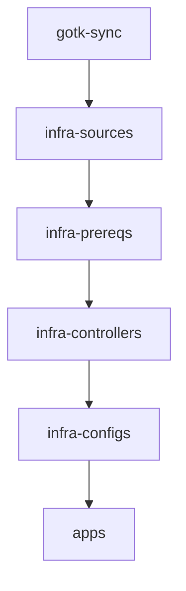

# AGENTS.md

> Operational manual, architectural context, and development guidelines for AI agents and human contributors working in `damoun/fleet-infra`.

---

## 1. Repository Overview

`fleet-infra` is a monorepo managing personal homelab and cloud infrastructure. It implements a decoupled Infrastructure-as-Code (IaC) and GitOps model:

- **OpenTofu**: Provisions cloud infrastructure (VMs, VPC, firewall, load balancer), machine operating systems (Talos Linux), overlay network access (NetBird), and Day-0 bootstrap secrets.
- **FluxCD (v2)**: Continuously reconciles in-cluster Kubernetes platform components, operators, ingress, network resources, and application workloads.

### Primary Cluster Specification
- **Cluster Name**: `dapl-prd-hom-ams-core` (Target baremetal homelab cluster; formerly `dapl-prd-htz-fsn-app` in Hetzner which is decommissioned)
- **Environment**: Homelab / Baremetal (Amsterdam location)
- **OS**: [Talos Linux](https://www.talos.dev/) (immutable, API-managed Linux)
- **CNI**: [Cilium](https://cilium.io/) (eBPF-based networking and kube-proxy replacement)
- **Overlay VPN**: [NetBird](https://netbird.io/) (WireGuard mesh network with custom internal DNS)
- **Secret Encryption**: [SOPS](https://github.com/getsops/sops) with [age](https://age-encryption.org/)

---

## 2. Tooling & Environment Setup

Tool versions are pinned in [`.tool-versions`](file:///home/damoun/Projects/github.com/damoun/fleet-infra/.tool-versions).

### Tool Management (`mise` / `asdf`)
[mise](https://mise.jdx.dev/) is the recommended runtime and tool manager (compatible with `asdf` `.tool-versions` files):

```bash
# Install pinned tool versions (OpenTofu, etc.)
mise install

# If using asdf
asdf install
```

### Essential CLI Utilities
- `tofu`: OpenTofu CLI for infrastructure provisioning.
- `kubectl` & `kustomize`: Inspecting and validating Kubernetes manifests.
- `flux`: FluxCD CLI for reconciliation and debugging.
- `sops`: Secret encryption and decryption.
- `gh`: GitHub CLI for pull requests and repository operations.

---

## 3. Repository Architecture & Layout

```
.
├── .github/workflows/          # CI/CD workflows (security scans)
├── .sops.yaml                  # SOPS encryption rules (age recipient & regex)
├── .tool-versions              # CLI tool versions for mise / asdf
├── docs/
│   ├── adr/                    # Architecture Decision Records (ADR-001 to ADR-006)
│   └── netbird-dns.md          # NetBird private access: naming, DNS, routing
├── tofu/                       # OpenTofu root modules (ADR-003)
│   ├── baremetal/              # Baremetal Talos configs, patches, cluster bootstrap (ams)
│   ├── hetzner/                # Hetzner Cloud VMs, network, firewall, LB (legacy)
│   ├── talos/                  # Talos machine configs, patches (legacy fsn)
│   └── kubernetes/             # Bootstrap secrets (sops-age, hcloud token)
├── clusters/
│   └── dapl-prd-htz-fsn-app/   # Flux cluster entrypoint & Kustomization roots (legacy root transitioning to dapl-prd-hom-ams-core)
│       ├── flux-system/        # Flux GOTK sync components & GitRepository
│       ├── infrastructure.yaml # Kustomizations: infra-sources -> prereqs -> controllers -> configs
│       └── apps.yaml           # Kustomization for application workloads
├── infrastructure/             # Cluster platform components
│   ├── sources/                # HelmRepository manifests
│   ├── prereqs/                # Priority classes, Cilium LB pool and policies
│   ├── controllers/            # HelmReleases & CRDs (Cilium, cert-manager, NetBird, etc.)
│   └── configs/                # Custom resources of the controllers (ClusterIssuers)
└── apps/                       # Application workloads
    ├── base/                   # Base Kubernetes manifests
    └── production/             # Production environment overlays
```

---

## 4. Architectural Rules & Decision Records (ADRs)

Always adhere to accepted ADRs located in [`docs/adr/`](file:///home/damoun/Projects/github.com/damoun/fleet-infra/docs/adr/):

### ADR-001: CIDR Allocation Strategy
Cluster networks strictly use subnets within `172.16.0.0/12` to prevent collisions with corporate VPNs (`10.0.0.0/8`), Docker bridge defaults (`172.17.0.0/16`), and home LANs (`192.168.0.0/16`):
- **Hetzner VPC Subnet**: `172.16.16.0/20`
- **Node Subnet**: `172.16.16.0/24` (Control plane: `172.16.16.5-7`, Workers: `172.16.16.8+`)
- **Pod CIDR**: `172.20.0.0/16`
- **Service CIDR**: `172.24.0.0/16`
> [!WARNING]
> Pod and Service CIDRs are immutable after bootstrap. Changing them requires rebuilding the cluster.

### ADR-002: Cilium Two-Phase Bootstrap
Talos Linux ships without a CNI.
- **Day-0 (Bootstrap)**: Cilium CLI installs initial CNI manually so nodes become Ready and Flux pods can schedule.
- **Day-2 (GitOps)**: FluxCD HelmRelease in [`infrastructure/controllers/cilium.yaml`](file:///home/damoun/Projects/github.com/damoun/fleet-infra/infrastructure/controllers/cilium.yaml) adopts and manages Cilium ongoing. Versions between CLI install and HelmRelease must stay aligned.

### ADR-003: Separate OpenTofu Root Modules
Providers must never be combined into a single monolithic root module. Each module in `tofu/` has independent state:
1. `tofu/hetzner/` (Provider: `hcloud`)
2. `tofu/talos/` (Provider: `talos`) — reads `hetzner` state via `terraform_remote_state`
3. `tofu/kubernetes/` (Provider: `kubernetes`) — reads `talos` state via `terraform_remote_state`
> [!IMPORTANT]
> Apply order is strictly: `hetzner` -> `talos` -> `kubernetes`.

NetBird is configured outside this repo, in `damoun/terraform` `stacks/netbird` (Spacelift).

### ADR-004 & ADR-005: Secrets Management & Ownership Boundary
- **Encryption Standard**: Only `age` keys (`age1...`) are used for SOPS encryption. Never use PGP.
- **Ownership Boundary**:
  - If a secret is required **before** Flux's first reconciliation, **OpenTofu owns it** in [`tofu/kubernetes/`](file:///home/damoun/Projects/github.com/damoun/fleet-infra/tofu/kubernetes/main.tf) (`sops-age` in `flux-system`, `hcloud` token in `kube-system`).
  - All other secrets (tokens, credentials, database passwords) belong in **SOPS-encrypted manifests committed to Git** managed by FluxCD.

### ADR-006: Hetzner-Native NTP & DNS
Talos nodes must use Hetzner datacenter services for lower latency and zero external dependency:
- **NTP**: `ntp1.hetzner.de`, `ntp2.hetzner.com`, `ntp3.hetzner.net`
- **DNS Resolvers**: `185.12.64.1`, `185.12.64.2`

### NetBird Private Access
Per [`docs/netbird-dns.md`](file:///home/damoun/Projects/github.com/damoun/fleet-infra/docs/netbird-dns.md):
- All ingress goes through NetBird. Services are `*.core.ams.damoun.casa` behind Gateway `gw` (namespace `edge`, VIP `172.28.0.10` from the never-announced LB pool `priv`); the kube API is `kube.core.ams.damoun.internal:443`.
- NetBird groups, policies, network, DNS zones and setup key live in `damoun/terraform` `stacks/netbird`; the in-cluster routing peers are the `rtr` Deployment in `infrastructure/controllers/`.

---

## 5. FluxCD & GitOps Best Practices

Flux reconciles the cluster according to a strict dependency graph defined in [`clusters/dapl-prd-htz-fsn-app/infrastructure.yaml`](file:///home/damoun/Projects/github.com/damoun/fleet-infra/clusters/dapl-prd-htz-fsn-app/infrastructure.yaml) and [`apps.yaml`](file:///home/damoun/Projects/github.com/damoun/fleet-infra/clusters/dapl-prd-htz-fsn-app/apps.yaml):



### GitOps Rules for Changes:
1. **Source References**: Every `HelmRelease` in `infrastructure/controllers/` must point to a corresponding `HelmRepository` in `infrastructure/sources/`.
2. **Kustomization Registration**: Any new YAML file must be declared in its directory's `kustomization.yaml`.
3. **Decryption Provider**: Kustomizations containing encrypted secrets must specify:
   ```yaml
   decryption:
     provider: sops
     secretRef:
       name: sops-age
   ```
4. **Priority Classes**: Infrastructure controllers and critical daemons must declare appropriate priority classes from [`infrastructure/prereqs/`](file:///home/damoun/Projects/github.com/damoun/fleet-infra/infrastructure/prereqs/):
   - `critical` (Cilium, Hubble relay, etc.)
   - `high` (tofu-controller, NetBird routers)
   - `medium`, `low`
5. **Pre-flight Validation**: Always validate manifests before committing:
   ```bash
   kubectl kustomize infrastructure/sources > /dev/null
   kubectl kustomize infrastructure/prereqs > /dev/null
   kubectl kustomize infrastructure/controllers > /dev/null
   kubectl kustomize infrastructure/configs > /dev/null
   kubectl kustomize apps/production > /dev/null
   ```

---

## 6. OpenTofu (IaC) Best Practices

1. **Formatting**: Always format code using `tofu fmt -recursive tofu/`.
2. **State Isolation**: Root modules must not share state directly; use `data "terraform_remote_state"` with local paths.
3. **Sensitive Data**: Mark all credentials and tokens with `sensitive = true`.
4. **Git Hygiene**:
   - Never commit `.tfstate`, `.tfstate.backup`, `.tfplan`, `.auto.tfvars`, or `.terraform/` directories.
   - Note: `.terraform.lock.hcl` is gitignored in this repository.

---

## 7. Secrets Management Workflow (SOPS + Age)

SOPS is configured via [`.sops.yaml`](file:///home/damoun/Projects/github.com/damoun/fleet-infra/.sops.yaml) to encrypt fields matching `^(data|stringData)$` using the repository's age public key.

> [!CAUTION]
> Never commit plaintext secrets to Git. Always ensure the YAML contains `sops:` metadata and encrypted strings (`ENC[...]`) before staging.

---

## 8. Common Operational Commands

Operations are executed directly using native CLI utilities:

### OpenTofu Operations
```bash
# Baremetal homelab module
tofu -chdir=tofu/baremetal init
tofu -chdir=tofu/baremetal plan
tofu -chdir=tofu/baremetal apply
```

### SOPS Secrets Operations
```bash
# Encrypt a secret in-place
sops --encrypt --in-place path/to/secret.yaml

# Decrypt for viewing/editing
sops --decrypt --in-place path/to/secret.yaml
```

### FluxCD Operations
```bash
# Force immediate reconciliation across all Flux Kustomizations
flux reconcile source git flux-system
flux reconcile kustomization infra-sources
flux reconcile kustomization infra-prereqs
flux reconcile kustomization infra-controllers
flux reconcile kustomization infra-configs
flux reconcile kustomization apps
```

---

## 9. Agent Operational Rules & Git Workflow

All automated agents and contributors must follow these strict practices:

1. **Dedicated Branches**:
   - Always branch off from a freshly fetched `origin/main`:
     ```bash
     git fetch origin main
     git checkout -b <type>/<short-description> origin/main
     ```
2. **Atomic Conventional Commits**:
   - Commit often in small, logical increments using [Conventional Commits](https://www.conventionalcommits.org/):
     - `feat: ...`, `fix: ...`, `chore: ...`, `docs: ...`, `refactor: ...`, `ci: ...`
3. **Selective Staging (Strict Guardrail)**:
   - **NEVER** run `git add .` or `git add -A`.
   - **ALWAYS** selectively stage files: `git add <path/to/specific-file>`.
4. **Pull Requests**:
   - Push the dedicated branch to origin:
     ```bash
     git push -u origin <branch-name>
     ```
   - Open a Pull Request using GitHub CLI (`gh`):
     ```bash
     gh pr create --title "<type>: <description>" --body "<summary>"
     ```
   - Prefer `gh` CLI over web fetching for repository interactions.
5. **Quality Verification**:
   - Run `tofu fmt -check -recursive tofu/`.
   - Run `kubectl kustomize <dir>` on modified Kustomize layers.
   - Run `git status` to ensure working tree hygiene before opening PRs.
